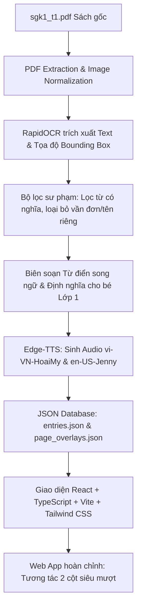

# BÁO CÁO TỔNG QUAN DỰ ÁN: BÉ TẬP ĐỌC LỚP 1
## Ứng Dụng Sách Giáo Khoa Tiếng Việt 1 Tích Hợp Từ Điển Song Ngữ Tương Tác

---

## I. TỔNG QUAN Ý TƯỞNG & BỐI CẢNH ĐỀ TÀI

### 1.1. Bối cảnh thực tế
- Học sinh bước vào Lớp 1 (6 tuổi) trải qua bước ngoặt chuyển đổi tâm lý từ môi trường "chơi là chính" ở mầm non sang môi trường "học tập có kỷ luật" ở tiểu học.
- Sách giáo khoa giấy truyền thống (bộ sách *Kết nối tri thức với cuộc sống*) rất phong phú về hình ảnh, nhưng thiếu tính tương tác động và phản hồi âm thanh. Trẻ dễ mau chán hoặc gặp khó khăn khi phụ huynh không có nhiều thời gian ngồi kèm phát âm từng chữ.
- Nhu cầu học tiếng Anh song hành ngay từ lớp 1 ngày càng cao. Tuy nhiên, cách dạy từ vựng tiếng Anh tách rời thường khiến trẻ học vẹt, khó liên hệ giữa từ ngữ tiếng Việt mẹ đẻ và từ tiếng Anh tương đương trong ngữ cảnh cuộc sống.

### 1.2. Ý tưởng cốt lõi
Xây dựng một nền tảng **Web Reader 2 cột (Dual-Pane) tương tác thông minh**:
- **Bên trái:** Trang sách PDF gốc được chuẩn hóa ở tỷ lệ chuẩn (55%), phủ lên từng hình ảnh/từ vựng các hộp tương tác (Bounding Box) tọa độ chính xác.
- **Bên phải:** Thẻ từ điển song ngữ hiển thị định nghĩa tiếng Việt phù hợp lứa tuổi 6 tuổi, đối chiếu từ vựng tiếng Anh kèm phiên âm quốc tế IPA và nút phát âm audio chuẩn bản ngữ (giọng đọc chuẩn tiếng Việt & tiếng Anh).
- **Trải nghiệm:** Chạm là đọc, cuộn là lật trang nhẹ nhàng, có sổ tay lưu từ riêng cho bé, đem lại cảm giác vừa thân thuộc như mở cuốn sách giáo khoa thật, vừa kỳ diệu và lôi cuốn như một ứng dụng công nghệ hiện đại.

---

## II. QUY TRÌNH KỸ THUẬT & CÁC TÍNH NĂNG ĐÃ TRIỂN KHAI

### 2.1. Kiến trúc hệ thống & Quy trình xử lý dữ liệu

### 2.2. Các module chức năng trọng tâm

| Module | Công nghệ & Giải pháp | Chức năng chi tiết |
| :--- | :--- | :--- |
| **PDF Page Viewer** | Canvas, Double-buffering, CSS Hardware Transform | Hiển thị 57 trang sách ở tỷ lệ cố định 55% chuẩn mắt trẻ em. Chuyển trang mượt mà không nhấp nháy trắng. |
| **Interactive Overlay** | Responsive % Hitboxes, Event Propagation Control | Định vị chính xác từng cụm từ trên ảnh scan (sai số < 0.2%). Chạm vào từ trên trang sách sẽ phát âm tiếng Anh và mở thẻ từ điển bên phải. |
| **Bilingual Dictionary** | Structured Data, Contextual Dictionary Mapping | Giải nghĩa tiếng Việt ngắn gọn, dễ hiểu kèm từ vựng tiếng Anh tương ứng trong bài, có đầy đủ từ loại và phiên âm IPA. |
| **Audio Engine** | Web Audio API, Preload Cache | Hệ thống âm thanh song ngữ tiếng Việt & tiếng Anh bản ngữ (103 từ vựng = 206 file mp3 chất lượng cao). |
| **Smart Gesture & Scroll** | Native Wheel Interceptor, Touch Manipulation | Khóa cuộn khung ngoài máy tính để chuột cuộn trong trang sách không bị trượt giao diện; vuốt dọc đổi trang êm ái. |
| **Sticky Note Guide** | CSS Post-It Note, Skew Transform | Bảng ghi nhớ màu vàng pastel ghim ở mép viền bên trái với thông điệp súc tích, ngộ nghĩnh cho bé. |
| **Sổ tay từ vựng của bé** | Local Storage Persistence, Modal Explorer | Cho phép bé thả tim/lưu lại các từ yêu thích để ôn luyện riêng biệt. |
| **Auto Setup CLI** | NPM Lifecycle Hook (`predev`, `ensure-deps.js`) | Tự động phát hiện và cài đặt thư viện (`npm install`) chỉ với 1 lệnh `npm run dev`. |

---

## III. NHỮNG ĐIỂM MẠNH & ĐIỂM NỔI BẬT VƯỢT TRỘI

### 1. Giữ trọn vẹn 100% nguyên bản Sách Giáo Khoa chuẩn Bộ GD&ĐT
- Không vẽ lại hoạt hình méo mó hay thay đổi bố cục, toàn bộ 57 trang sách đều là bản scan gốc chất lượng cao của bộ sách *Kết nối tri thức với cuộc sống*.
- Trẻ học trên ứng dụng sẽ có cảm giác hoàn toàn quen thuộc với cuốn sách các em cầm trên tay mỗi ngày ở trường lớp.

### 2. Giải nghĩa tiếng Việt ngây thơ, đúng tâm sinh lý trẻ 6 tuổi
- Thay vì sao chép định nghĩa hàn lâm, từ điển sử dụng ngôn ngữ giàu hình ảnh và tình cảm:
  - *Ví dụ từ "bà":* "Người phụ nữ lớn tuổi, là mẹ của bố hoặc mẹ, luôn thương yêu cháu."
  - *Ví dụ từ "gia đình":* "Tổ ấm gồm có ông bà, cha mẹ và con cái cùng sống yêu thương, gắn bó với nhau."
  - *Ví dụ từ "búp bê":* "Đồ chơi mô phỏng hình em bé hoặc bạn nhỏ xinh xắn, đáng yêu."

### 3. Phương pháp học từ vựng tiếng Anh theo ngữ cảnh (Contextual English)
- Không bắt trẻ học từ tiếng Anh rời rạc, mà từ tiếng Anh được đặt cạnh từ tiếng Việt trong bài đọc:
  - Khi đọc bài *Ca hát*, bé tiếp thu từ `sing /sɪŋ/`.
  - Khi xem bài *Đồ dùng học tập*, bé học `pencil`, `ruler`, `notebook`, `eraser`, `book`.
  - Khi gặp *Gia đình*, bé học `family`, `grandmother`, `father`, `mother`.
- Giúp trẻ hình thành phản xạ kết nối ngôn ngữ tự nhiên từ sớm.

### 4. Tương tác đa giác quan: "Nhìn - Chạm - Nghe - Đọc"
- Khi trẻ chạm vào ô chữ trên trang sách, loa phát âm tiếng Anh vang lên ngay lập tức, kích thích thính giác và sự tò mò.
- Ở khung từ điển, trẻ có thể chọn nghe lại cả phát âm tiếng Việt chuẩn Hà Nội (`vi-VN-HoaiMyNeural`) hoặc tiếng Anh chuẩn Mỹ (`en-US-JennyNeural`).

### 5. Giao diện thân thiện, hạn chế tối đa thao tác thừa
- Đã loại bỏ các nút bấm kỹ thuật gây rối mắt như nút phóng to/thu nhỏ hay các thông số meta (`Trang PDF nguồn:...`).
- Khung hiển thị cố định 55% giúp vừa vặn tầm mắt mọi màn hình laptop, không bị thanh Taskbar máy tính che khuất.
- Cố định khung sách để thao tác cuộn chuột chuyển trang tự nhiên như lật từng tờ giấy.

---

## IV. GIÁ TRỊ VÀ CÁCH ÁP DỤNG ĐỐI VỚI HỌC SINH LỚP 1

### 4.1. Hỗ trợ trẻ tập đọc và ghi nhớ mặt chữ tiếng Việt
- Trẻ lớp 1 đang ở giai đoạn ghép vần, thường gặp khó khăn với các từ ghép hoặc từ tượng thanh, tượng hình (`ríu rít`, `ngọt lừ`, `gốc đa`, `ba ba`).
- Khi gặp từ khó trong bài, bé chỉ cần nhấn vào từ đó trên màn hình để nghe máy đọc mẫu, đọc phần diễn giải và ghi nhớ nghĩa, từ đó tự tin đọc to trước lớp.

### 4.2. Khơi gợi tính tự lập và tự học tại nhà
- Giao diện có bảng chỉ dẫn dạng **Sticky Note ghim viền**:
  - 👆 *Chạm từ có viền để nghe đọc*
  - 🖱️ *Cuộn chuột để lật trang sách*
- Giúp trẻ chỉ cần 30 giây làm quen là có thể tự điều khiển, tự học mà không nhất thiết phải có phụ huynh kè kè bên cạnh liên tục.

### 4.3. Biến giờ học thành trải nghiệm khám phá thú vị
- Thay vì bị ép đọc sách giấy khô khan, trẻ được chủ động bấm tìm các "kho báu" (những ô từ vựng được bao viền cam).
- Tính năng **Sổ tay của bé** kích thích tâm lý thích sưu tầm: mỗi khi tìm được một từ mới, bé bấm nút "Lưu từ này" để tích lũy vào bộ sưu tập từ vựng của riêng mình.

### 4.4. Công cụ hỗ trợ đắc lực cho Giáo viên & Phụ huynh
- **Trên lớp:** Giáo viên có thể trình chiếu trực tiếp trên bảng tương tác thông minh (Smart Board), cho cả lớp cùng chạm vào từ để nghe phát âm song ngữ chuẩn.
- **Ở nhà:** Phụ huynh không tự tin về phát âm tiếng Anh chuẩn bản ngữ vẫn hoàn toàn yên tâm cho con học từ điển tích hợp sẵn.

---

## V. ĐỊNH HƯỚNG PHÁT TRIỂN MỞ RỘNG (ROADMAP)

1. **Công nghệ nhận diện giọng nói (Speech Evaluation):** 
   - Tích hợp micro thu âm giọng đọc của bé, sử dụng AI nhận diện và chấm điểm xem bé đọc đã chuẩn tiếng Việt và tiếng Anh hay chưa.
2. **Minigame tương tác ôn tập:**
   - Trò chơi ghép từ tiếng Việt với tranh minh họa, chọn từ tiếng Anh tương ứng để nhận sao thưởng.
3. **Mở rộng toàn bộ bộ sách:**
   - Hoàn thiện tiếp Tập 2 Tiếng Việt 1 và mở rộng sang các khối lớp 2, 3, 4, 5.

---

## VI. KẾT LUẬN

Dự án **"Bé Tập Đọc Lớp 1"** không chỉ đơn thuần là việc số hóa một cuốn sách PDF lên web, mà là một **giải pháp công nghệ giáo dục (EdTech) hoàn chỉnh**, kết hợp hài hòa giữa **chương trình giáo dục phổ thông quốc gia** và **phương pháp tiếp cận song ngữ hiện đại**. 

Ứng dụng đáp ứng trọn vẹn cả 3 tiêu chí: **Tính sư phạm chuẩn mực**, **Tính thẩm mỹ trẻ thơ** và **Trải nghiệm công nghệ mượt mà**, mang lại giá trị thiết thực cho học sinh, phụ huynh và nhà trường trong kỷ nguyên chuyển đổi số giáo dục.
